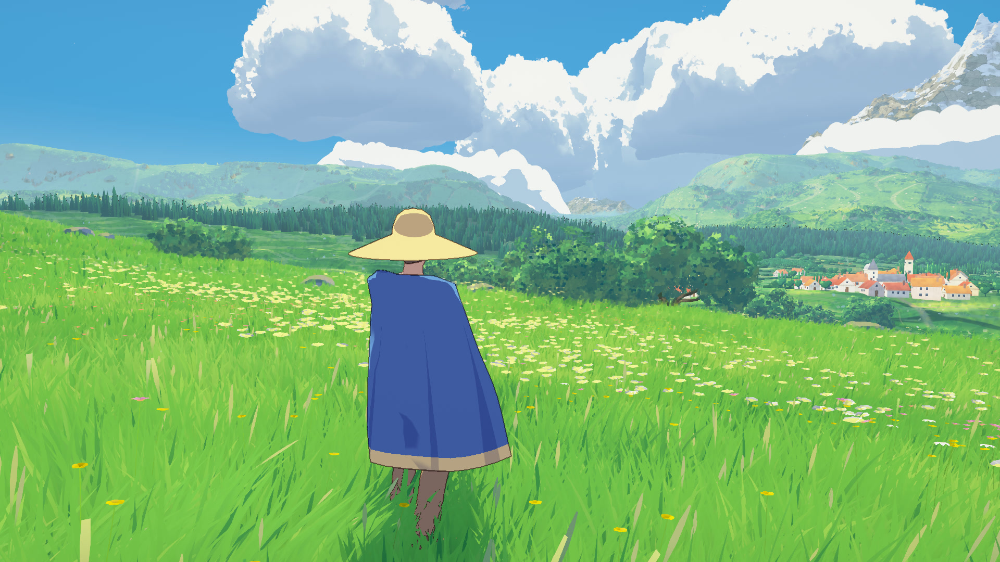
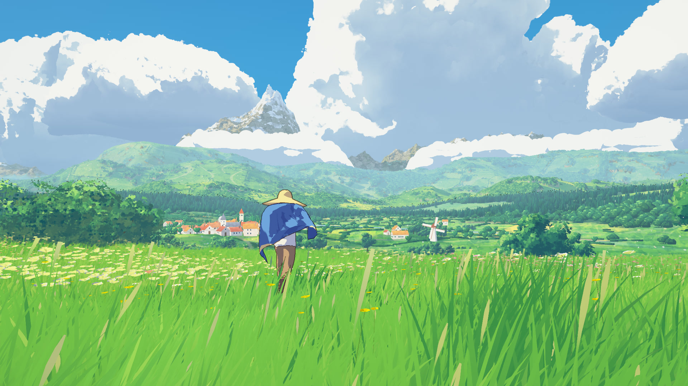
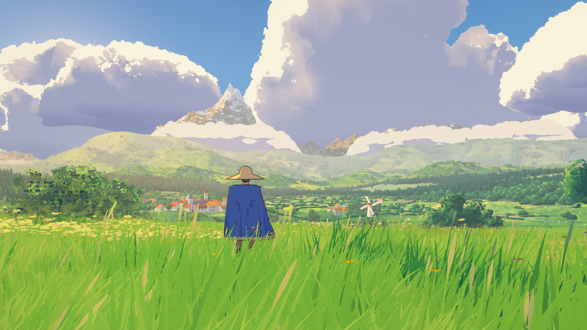
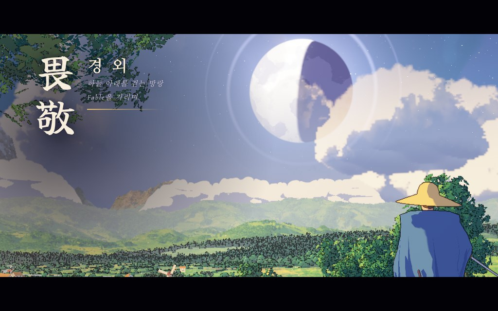
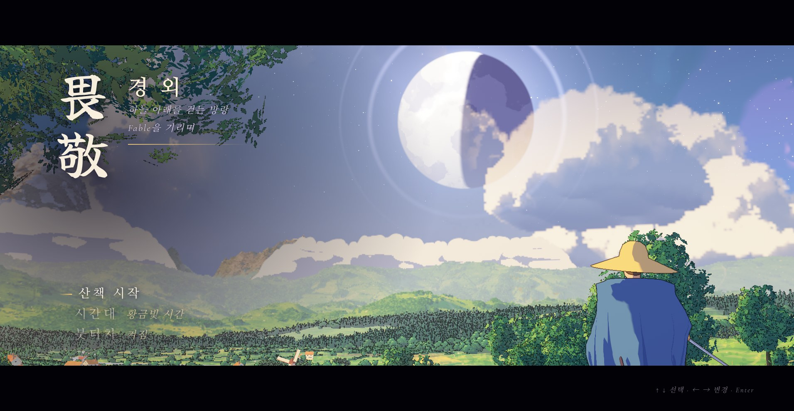
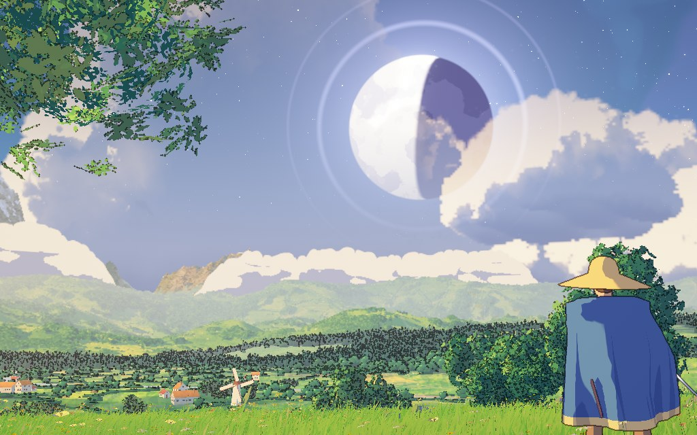

# 경외(敬畏) · 물감으로 그린 계곡 한글판

손으로 그린 애니메이션 영화 배경 같은 여름 계곡을 걸어다니는 three.js 데모입니다. 평평하고 깨끗한 색면, 소복이 쌓인 흰 구름, 매면이 하나하나 그려진 먼 산, 기와지붕 마을, 그리고 발밑에서도 붓자국이 둥글게 유지되는 초원으로 이루어져 있습니다. 밀짚모자에 푸른 망토를 두른 방랑자가 이 계곡을 걷습니다. 땅과 하늘은 모두 코드로 만들어졌습니다.

이 저장소는 [Patch의 @majveia가 만든 Painted Valley(Reverence 리믹스)](https://patch.gg/majveia/painted-valley)([원본 소스](https://git.patch.gg/majveia/painted-valley.git))를 한국어로 옮긴 한글화 포크입니다. 원작의 라이선스(코드 MIT, 아트 CC0 1.0)에 따라 번역·배포하며, 원문 README는 [README.en.md](README.en.md)에 그대로 보존되어 있습니다.



## Reverence — 영화 같은 오프닝

*Fable을 기리며, painted valley를 리믹스한 버전입니다.*

영화처럼 시작합니다. 검은 레터박스, 풀 위를 지나는 바람, 커다란 달 아래 카타나를 뽑아 든 방랑자, 그리고 붓으로 쓴 제목. 아무 키나 누르면 선택지(시작, 시간대, 붓터치)가 나오고, 시작하면 그는 칼을 거두어들이고 레터박스가 걷히며 시점이 그의 뒤로 내려옵니다. 물감으로 그린 낮 하늘 너머로 천구가 비쳐 보입니다. 성운의 강, 멀리 있는 두 나선 은하, 별들, 그리고 후광을 두른 달이 정오에는 희미하게, 노을 질 무렵에는 또렷하게 드러납니다.

**추가된 키:** F로 카타나를 뽑거나 거둡니다. 타이틀 화면에서 W A S D를 누르면 바로 시작합니다.

| | |
|---|---|
| `src/valley/katana.js` | 검과 검집, 발도와 납도 |
| `src/valley/sky.js` | `heavens()`와 `moon()`: 성운, 나선 은하, 별, 달. `sky.cosmos`로 얼마나 보일지 조정 |
| `src/valley/main.js` | 타이틀: 카메라, 선택지, 산책으로 내려가는 연출 |
| `src/valley/sounds.js` | 발도·납도 소리, 바람 소리와 긴 화음. 모두 노이즈와 톤으로 합성 |

`?notitle`로 타이틀을 건너뛰고, `?hour=15.5`로 다른 시간대에서 시작할 수 있습니다(타이틀은 황금빛 시간에서 시작합니다).

## 데모 조작법

클릭하면 마우스로 둘러보기, WASD 이동, Shift 달리기, Alt 걷기, Space 점프, 휠로 시점을 뒤로/앞으로. 게임패드도 됩니다. V를 누르면 방랑자의 눈(1인칭)으로 들어갔다 나옵니다. T로 시간대(정오, 오후, 황금빛 시간, 노을)를 바꾸고, 1~4로 바로 이동합니다. `,`와 `.`로 시간을 조금씩 움직이고, 0은 시간이 저절로 흐르게 합니다. P로 붓터치 마감을 끄고 켭니다. 할 일은 걷는 것뿐입니다. 언덕을 내려가 마을로, 강을 따라, 그리고 못까지 걸어 보세요.





이 프로젝트는 필터가 아니라 출발점입니다. 완성된 게임 위에 덧씌울 수는 없습니다. 이 느낌은 장소의 각 부분을 어떻게 그리느냐에서 나오기 때문입니다. 이 계곡에서 시작해 바꾸고, 여러분의 게임을 담으세요.

## 아이디어

손으로 그린 배경이 '그림'으로 읽히는 이유는 빼 놓은 것에 있습니다. 사진 텍스처도, 모든 크기에서의 노이즈도 없고, 색조는 적으며, 디테일은 붓이 놓였을 자리에만 있습니다.

- **물감처럼 고른 적은 색조.** 모든 사물은 빛받은 색과 그림자 색, 그리고 그 사이의 짧은 단계를 가집니다. 하나의 공유 팔레트(`src/valley/world.js`의 `meadowGreen`, `meadowLight`)가 풀, 그 아래 땅, 먼 들판과 언덕을 칠해 계곡 전체가 한 장의 그림이 됩니다.
- **노이즈가 아니라 붓자국.** 초원은 경사를 따라 흐르는 가는 선과, 산책이 시작되는 언덕에서 바라본 모습 그대로 배치된 덧칠(`heroPaint`)로 이루어져, 그 자리에서는 둥글게 보이다가 얼룩처럼 보이기 전에 사라집니다. 먼 땅에는 미세한 무늬가 아예 없습니다. 그랬다면 아른거렸을 테니까요.
- **먼 것은 한 번만 그립니다.** 산은 하이트맵을 한 장의 그림 띠(빛받은 색, 그림자 색, 빛이 닿는 곳, 대기, 구름 띠)로 레이 마칭해 두고, 하늘이 시간대에 맞춰 그 빛을 다시 칠합니다. 바위는 면으로 깎이고, 낮은 비탈에는 둥근 수관이 올라가며, 세 줄기의 앞산들이 안개 속으로 물러납니다. 먼 것은 프레임당 비용이 들지 않습니다.
- **구름은 솜뭉치.** 각 적운은 구를 쌓아 만든 뒤 큐브맵에 한 번 레이 마칭하고 평평한 색조를 입힙니다. 흰 윗면, 차가운 그림자, 따뜻한 밑면. 일부러 움직이지 않고, 시간대마다 다시 그릴 때 빛이 바뀝니다.
- **평원도 한 장의 그림.** 들판, 생울타리, 길과 강은 하나의 텍스처로 그려지고, 나무와 과수원, 포플러와 풍차가 작은 그림 카드처럼 그 위에 서 있습니다.
- **건물은 배경 화가가 디테일을 주는 방식 그대로.** 기와 줄, 처마 밑 얼룩이 든 회벽, 덧문, 문, 다락 창, 굴뚝까지 전부 벽의 좌표만으로 셰이더 안에서 그립니다.
- **프레임 위의 마감**(작은 Kuwahara 패스)이 모든 것을 붓터치처럼 둥글게 다듬고, 하늘처럼 제외해 달라고 한 것들은 남겨 둡니다.
- **사람은 물감이 아니라 셀.** 영화는 배경을 그리고 사람은 잉크로 그립니다. 그 차이가 이 느낌의 큰 부분입니다. 방랑자는 세 가지 평면 색조(빛, 그림자, 주름 깊은 곳)로, 경계는 깨끗하게 나뉩니다. 그림자 색은 밝은 색을 어둡게 하는 게 아니라 보여야 할 모습으로 섞습니다. 그의 각 부분은 프레임의 알파에 작은 숫자를 쓰고, 마지막 패스가 서로 다른 숫자가 만나는 곳에 선을 긋습니다. 다른 물체가 앞에 있는 곳은 제외해서, 그가 서 있는 풀밭에는 선이 그어지지 않습니다. 망토는 진짜 천이고, 자락에서 올라오는 주름 그림자 몇 개는 화가가 하듯 그려 넣었습니다. 풀 위의 그림자는 해가 내려갈수록 길어지는 깨끗한 가장자리의 도형입니다.

## 게임에 사용하기

이것은 머티리얼이 아니라 자체 렌더러 설정을 가진 장소입니다. `src/valley/main.js`가 데모 전체이자 시작점입니다. three 0.186, WebGL2 기반입니다.

```js
import { createField, createFrame } from './src/lib/index.js';
import { createSky } from './src/valley/sky.js';
import { createTrees } from './src/valley/trees.js';
import { heightAt, START } from './src/valley/world.js';

const field = createField({ /* 초원: 풀, 꽃, 땅. main.js 참고 */ });
const frame = createFrame(renderer, field, { samples: 4, bloom: 0.1 });
const sky = createSky(renderer, field, { /* 구름과 산은 여기서 그려집니다 */ });
scene.add(sky.mesh, createTrees(field).group);

frame.paint = 3;                    // 붓터치 마감: 0이면 끔
sky.setHour(15.5);                  // 정오 12.5부터 노을 20.4까지
camera.position.y = heightAt(x, z) + 1.7;
frame.render(scene, camera);
```

- **여러분의 사물 넣기.** 평소처럼 씬에 메시를 추가하면 됩니다. 붓터치 마감에서 빼려면(선명한 캐릭터, 월드 내 HUD) 알파를 0.6 아래로 쓰세요. 계곡의 빛에 맞추려면 `field.uniforms`에서 태양과 하늘 색을 읽으세요.
- **여러분의 사람 넣기.** `src/valley/wanderer.js`가 셀 룩입니다. 리깅 여부와 상관없이 어떤 메시에도 빛 색과 그림자 색, 0.23 아래의 선 번호로 재질을 입힐 수 있습니다(번호가 다른 부분 사이에 선이 그어집니다). `field.uniforms.uWalker`(x, z, 어둡기, 길이)는 초원 위에 방랑자의 그림자 하나를 깝니다. 그의 움직임, 카메라, 천은 `src/figure/`에 있고, Rapier 위에서 돌며, Patch의 유화 블록(`blendi/oil-paint`)에서 가져왔습니다.
- **장소 바꾸기.** `src/valley/world.js`가 땅입니다: `heightAt`, 오솔길, 못, 강, 마을과 숲의 위치. `village.js`는 여덟 가지 형태로 집을 만듭니다. `backdrop.js`는 산의 윤곽, `clouds.js`는 각 구름의 위치입니다.
- **시간대 바꾸기.** `sky.js`에 시간대 키마다 색 세트가 있습니다. 밤, 폭풍, 새벽을 추가해 보세요.
- **성능 모드.** `?quality=low`나 `medium`은 더 적게 그립니다. 풀잎 수 감소, 씨앗 솜털 제거, 가벼운 마감.

## 파일 구성

| | |
|---|---|
| `src/valley/main.js` | 데모: 시작, 방랑자, 키 입력, 루프 |
| `src/valley/world.js` | 땅과 공유 팔레트 |
| `src/valley/sky.js`, `clouds.js`, `backdrop.js` | 하늘과 시간대, 구름, 먼 산과 앞산들 |
| `src/valley/horizon.js`, `floor.js`, `farwoods.js` | 6km까지 이어지는 평원, 그려진 들판과 길, 나무와 풍차 |
| `src/valley/village.js` | 집, 교회, 헛간 |
| `src/valley/trees.js`, `dressing.js`, `water.js` | 그늘 있는 가까운 나무와 덤불, 돌과 떠다니는 씨앗, 못 |
| `src/valley/strokes.js` | 땅을 칠하는 붓자국 텍스처 |
| `src/valley/sounds.js` | 소리(아래 '소리' 참고) |
| `src/valley/wanderer.js` | 방랑자의 모습: 셀 색, 모자와 망토, 선이 그어지는 기준 |
| `src/figure/` | 스타터 맨과 움직임: `man.js`(로딩), `animator.js`, `player.js`(Rapier 캐릭터), `input.js`, `camera.js`(그의 뒤의 시점), `cloak.js`(천) |
| `src/lib/` | 풀, 꽃, 땅, 프레임. Patch의 풀 블록(`blendi/touch-grass`)에서 가져와 이 느낌으로 다시 스타일링 |
| `tools/` | 헤드리스 스틸 컷(`shots.mjs`, 방랑자용 `walk.mjs`), 프레임 시간(`fps.mjs`), 첫 방문(`cold.mjs`), 소리 자르기(`sounds.mjs`), `compact-glb.mjs`(클립이 쓰는 것만 남긴 파일) |

## 소리

공개된 원작 데모에는 풀 속 바람, 나뭇잎, 새와 벌레, 못가의 물소리, 해 질 녘 귀뚜라미 소리가 있습니다. 이 다섯 개의 녹음은 Sonniss GDC 번들에서 가져온 것으로, 게임 안에서 사용하는 것은 허용되지만 파일 그대로 전달하는 것은 금지되어 **이 저장소에도 포함되어 있지 않습니다**. 이 저장소만으로 빌드하면 발자국 소리만 들립니다. [MISSING_ASSETS.md](MISSING_ASSETS.md)에 각 녹음의 이름, 얻는 곳, 다시 넣는 명령 하나가 적혀 있습니다. 한글판 배포본도 원작과 같은 조건을 지켜 환경음은 포함하지 않았습니다.

## 한계

- WebGL2 위의 three.js 전용입니다.
- 계곡 하나, 약 2km 너비에 산까지 이어지는 그려진 땅. 가장자리를 지나가면 방향이 돌려집니다.
- 정오부터 노을까지만. 밤은 없고, 구름은 움직이지 않습니다.
- 집 안에는 들어갈 수 없고, 아직 아무도 살지 않습니다.
- 방랑자는 한 얼굴의 한 사람으로, 몇 미터 거리에서 보기 위해 만들어졌습니다. 그의 눈으로 볼 때는 몸이나 손이 보이지 않습니다.
- RTX 4090, 1080p에서만 측정되었습니다. 첫 방문 준비는 그 환경에서 약 8초, 다운로드는 약 13MB입니다.

## 빌드

`npm install` 후 `npm run build`: `dist/`에 데모가 만들어지고 `index.html`이 맨 위에 있습니다. `npm run serve`는 5383 포트에서 서빙합니다. `tools/`의 도구들은 Playwright로 헤드리스 구동합니다. Playwright에 Chromium이 없으면 `CHROME`으로 직접 지정하세요.

## 한글화 내용

- 타이틀 화면(제목·부제·메뉴·안내문), 로딩 단계 문구 8개, 시간대 이름 4개, 조작 안내, 상태 메시지(발도/납도, 1인칭/3인칭, 시간 흐름) 등 사용자에게 보이는 문구를 한국어로 번역했습니다.
- 원본 폰트(Yuji Syuku, Cormorant Garamond)는 한글을 포함하지 않아, 명조체 느낌이 어울리는 **나눔명조(Nanum Myeongjo, OFL)** 웹폰트를 화면에 쓰는 글자만 추린 서브셋(각 약 12KB)으로 추가했습니다. 영문과 한자는 원본 폰트 그대로 표시됩니다.
- 붓으로 쓴 세로 타이틀 畏敬(한자)은 원작 그대로 유지하고, 한글 제목 '경외'를 곁들였습니다.
- 코드와 원작의 구조·식별자·주석은 원본 그대로 유지했습니다.

### 한글판 실행 화면

배포된 한글판(<https://sigco3111.github.io/painted-valley-ko/>)의 실제 실행 화면입니다.







## 라이선스

코드 MIT, 아트 CC0 1.0. 방랑자는 Patch의 스타터 맨(MakeHuman 피규어, CC0)에 Quaternius의 Universal Animation Library(CC0)와 Patch 자체 클립(CC0)으로 움직입니다. 물리는 Rapier(Apache-2.0), 오솔길의 흙은 ambientCG의 두 텍스처(CC0), 발자국 소리는 Kenney(CC0)입니다. 그 외에 보이는 모든 것은 코드로 만들어졌습니다. 모든 부분과 출처는 [LICENCE-NOTES.md](LICENCE-NOTES.md)에 있습니다. 한글 폰트 나눔명조는 SIL Open Font License(`public/fonts/NanumMyeongjo-OFL.txt`)입니다.
